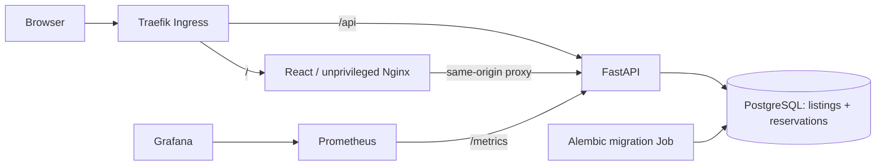
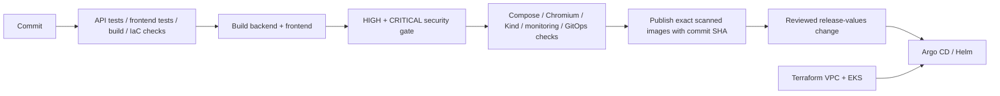

# LastBite

**Good food. Second chance.** LastBite is a surplus-food rescue application in the **restaurant management** domain. Kitchens publish discounted meal boxes, customers reserve available portions, and staff confirm pickup with a code. The impact dashboard counts actual collected boxes and the savings on those pickups.

Built for the DevSecOps capstone using React, FastAPI, PostgreSQL, Docker, GitHub Actions, Trivy, Terraform, Kubernetes, Helm, Argo CD, Prometheus and Grafana.

## Run locally

```bash
cp .env.example .env
docker compose up --build -d --wait
python3 scripts/seed.py
```

Default addresses: **http://localhost:3000** for the app and **http://localhost:8000/docs** for API documentation. Set `FRONTEND_PORT` and `BACKEND_PORT` in `.env` if those ports are occupied. This workspace's ignored `.env` uses **3002** and **8002**; seed it with `python3 scripts/seed.py --url http://localhost:8002`.

The seed script adds six fictional kitchens, eight completed meal pickups, and a pending reservation. It refuses to change a non-empty database. Pickup times are relative to when it runs, so sample listings eventually expire just like real ones. Publish new boxes from Kitchen desk for a later demonstration.

- **Explore boxes:** browse available meals, bakery items, produce and desserts; search kitchens; filter dietary preference; view pickup times, prices and allergens.
- **Reservations:** view pickup codes, cancel an uncollected reservation, or confirm handover with a matching code during the pickup window.
- **Kitchen desk:** publish, edit, pause and delete meal listings. Listings with reservation history are retained.
- **Impact dashboard:** available boxes, collected meals, active kitchens and savings from confirmed pickups. All figures come from the database.

This is a shared classroom demo without accounts or real payment processing. All reservations and kitchen controls are visible to all demo users. Each box represents one meal for the demo's impact count. Prices are in INR; payment at pickup is descriptive, not a payment integration. Use fictional data. Authentication, role enforcement and payment reconciliation are future work before a public deployment.

```bash
docker compose ps
docker compose logs backend migrate
docker compose down       # retain data
# Only to intentionally discard this demo database:
docker compose down -v
```

## Architecture





## Domain rules

1. Prices are integer paise, avoiding floating-point money calculations. Rescue price cannot exceed original value. Stock and quantities must be positive integers.
2. Reserving a box locks its listing in PostgreSQL and conditionally decrements stock in the same transaction as creating the reservation. Competing requests cannot oversell the last box.
3. Cancellation before pickup ends restores stock exactly once. Duplicate cancellation or pickup returns `409`.
4. Pickup requires a matching code and must occur between the listing's start and end times. Only confirmed pickups count towards meals rescued and savings.
5. Expiration is derived from the current UTC time on every API request, with no scheduler required. Expired reservations cannot be collected or cancelled. Expired listings leave the marketplace; their history remains in the kitchen desk.
6. Once any reservation exists, food details, allergens, prices, address and pickup window are immutable. Kitchens may adjust total stock (never below reserved/collected quantities) or pause new reservations. Existing reservations can still be collected while the listing is paused.
7. Listings with reservation history cannot be deleted. This protects pickup records and impact totals. An unreserved listing can be deleted.
8. All API times include timezone information; the UI displays the browser's local time. Listings and reservations are paginated. Marketplace data refreshes every 30 seconds, and the server rechecks availability on submission.

## API

| Method | Endpoint | Purpose |
|---|---|---|
| GET | `/health` | Process liveness |
| GET | `/ready` | Verify both migrated application tables and DB connection |
| GET | `/metrics` | Prometheus request counts and latency |
| GET / POST | `/api/listings` | Search/filter/paginate listings or publish a box |
| GET / PUT / DELETE | `/api/listings/{id}` | Read, update or delete an unreserved listing |
| POST | `/api/listings/{id}/reservations` | Reserve stock atomically |
| GET | `/api/reservations` | Paginated shared-demo reservation history |
| POST | `/api/reservations/{id}/cancel` | Release a reservation's stock |
| POST | `/api/reservations/{id}/pickup` | Confirm collection using `pickup_code` |
| GET | `/api/stats` | Persistent food-rescue impact totals |

Listing filters: `category`, `dietary`, `state`, `q`, `limit`, `offset`. Categories: `MEALS`, `BAKERY`, `PRODUCE`, `DESSERTS`. Dietary values: `VEGETARIAN`, `VEGAN`, `MIXED`. States: `AVAILABLE`, `SOLD_OUT`, `PAUSED`, `EXPIRED`. Missing resources return `404`, invalid payloads `422`, and stock/state conflicts `409`.

`PUT` expects the complete writable listing representation. The frontend's `writeFields` helper excludes computed state, ID, timestamps and available-stock counters.

## Data and migrations

`0002_lastbite` creates `listings` and `reservations` with foreign keys, quantity/price/window checks and indexes. The historical `0001_tickets` migration is preserved so an existing RelayDesk database can upgrade without rewriting its migration history or deleting its old records. LastBite does not expose the old ticket tables or API. A fresh installation applies both revisions; rollback drops LastBite's tables and leaves the old revision intact.

Compose creates a separate `lastbite_postgres-data` volume. Kubernetes uses `lastbite` resource names and a separate database secret. Existing RelayDesk data and deployment evidence are not relabelled as LastBite data.

## Development and tests

Python 3.12 and Node 22 are used by CI. Dependencies are pinned in `backend/requirements*.txt` and `frontend/package-lock.json`.

```bash
python3.12 -m venv .venv
.venv/bin/pip install -r backend/requirements-dev.txt
cd backend
../.venv/bin/python -m pytest -v
cd ../frontend
npm ci
npm test
npm run build
```

The API tests always use a temporary SQLite database unless `TEST_DATABASE_URL` explicitly points to a disposable PostgreSQL database. They apply real migrations, exercise competing reservations and cancellations, validate pickup timing, and downgrade at teardown. Never use a production database for `TEST_DATABASE_URL`.

For real browser tests against the running stack:

```bash
cd frontend
npx playwright install chromium
FRONTEND_URL=http://localhost:3002 npm run test:e2e
```

The browser suite publishes a listing, reserves/cancels/re-reserves, checks pickup-code errors, confirms a pickup, reloads persisted state, edits stock, deletes an unreserved listing, and checks mobile overflow. Synthetic listings with reservation history are paused rather than erased. The smoke test likewise preserves its reservation history:

```bash
python3 scripts/smoke.py --frontend-url http://localhost:3002 --backend-url http://localhost:8002
```

For direct API development, use `DATABASE_URL=sqlite:///./lastbite.db` and run `alembic upgrade head` before Uvicorn. Vite's dev proxy defaults to backend port 8000. PostgreSQL is the full deployment database.

## Delivery, infrastructure and security

- Both containers run as non-root users; the frontend is a multi-stage Node/Nginx image. Compose binds published ports to loopback.
- CI tests against PostgreSQL before building. Trivy scans both images and blocks publication on HIGH or CRITICAL findings, including unfixed findings. No blanket CVE exclusions are configured.
- Only successful main builds publish to GHCR. Images use the full Git commit SHA. Integration checks run against the exact candidate images; pull requests do not publish.
- `helm/lastbite` deploys two frontend replicas, two backend replicas (or an HPA), PostgreSQL on a PVC, migration Job, Services and Ingress. Secrets are referenced, not committed.
- Terraform provisions two public and two private subnets, a NAT gateway, EKS, managed workers and EBS CSI. The example uses `m7i-flex.large`, which worked in the configured account during the verified LastBite demo; recheck account eligibility and region capacity before deploying.
- Prometheus scrapes `lastbite_http_requests_total` and the latency histogram. Grafana panels show traffic, p95 latency, errors and available replicas. Metric labels use route templates, not individual IDs.
- See [deployment steps](docs/DEPLOYMENT.md), [Terraform notes](terraform/README.md), and [isolated troubleshooting exercises](troubleshooting/README.md).

## Publication status

Source repository: [THRISHAL12345/lastbite](https://github.com/THRISHAL12345/lastbite). The application conversion uses author and committer `THRISHAL12345 <73953301+THRISHAL12345@users.noreply.github.com>`. The repository was renamed from RelayDesk using `gh-personal`.

Use `gh-personal` for future GitHub operations and retain the `THRISHAL12345` commit identity.

The Argo Application points to the `lastbite` repository and its `helm/lastbite` chart. `values-release.yaml` pins the scanned and published LastBite revision `178015224d2786be2f2621554e6d09beb25d01b2`. For future releases, generate values only after the new CI run and both image pushes succeed:

```bash
python3 scripts/promote.py THRISHAL12345 FULL_40_CHARACTER_LASTBITE_COMMIT_SHA
```

Do not apply the Argo Application before the repository and tested images exist. Do not let Helm CLI and Argo CD own the same resources simultaneously.

## Evidence and presentation

- [Validation record](docs/VALIDATION.md): checks actually run for LastBite.
- [Submission checklist](docs/SUBMISSION-CHECKLIST.md): required new evidence.
- [Recording guide](demo/RECORDING.md) and [slides](demo/slides.pdf).
- [Scorecard](docs/SCORECARD.md), [submission evidence](demo/evidence/README.md), and [security results](docs/SECURITY-RESULTS.md).
- `demo/legacy-relaydesk/` contains historical, unchanged RelayDesk evidence. It is not proof of LastBite deployment or CI.
- LastBite was deployed to a real EKS cluster in `ap-south-1`, verified with live monitoring, and then removed. [AWS proof and cleanup verification](demo/evidence/aws/README.md) are archived; recreate the demo for your recording.

## Known limits

This classroom application has no authentication, customer isolation, online payments, notifications, geolocation or food-safety certification. Pickup codes support the workflow but are not an authorization boundary in the shared demo. A response lost after reservation creation can lead to a duplicate if retried; production needs authenticated idempotency keys. Expiration is evaluated on access, not persisted by a background worker. PostgreSQL is a single in-cluster instance and needs backups for production. The gp3 storage class retains disks: remove retained EBS volumes explicitly during cleanup. Remote fonts have system fallbacks.
