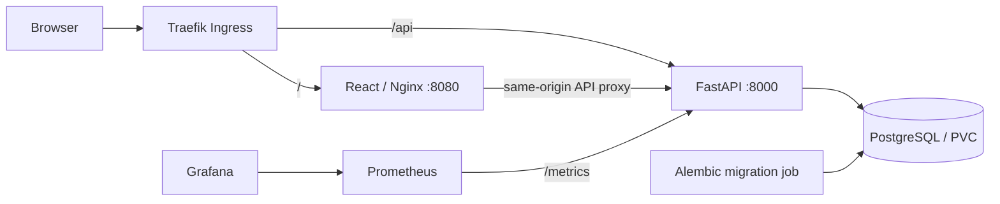
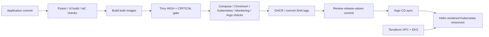

# RelayDesk

An original IT helpdesk built for the DevSecOps capstone. RelayDesk gives support teams a searchable ticket queue, clear ownership, continuous resolution targets, and a history of updates and team notes.

This is a new project based on the **requirements and delivery architecture** of `devsecops-python-main`, with a different domain, data model, API, interface, tests, and operational configuration. The reference folder remains separate.

## Start here

Repository: [THRISHAL12345/relaydesk](https://github.com/THRISHAL12345/relaydesk).
For the remaining AWS, recording and submission actions, follow
[your complete step-by-step handoff](docs/YOUR-NEXT-STEPS.md).

Requirements: Docker Engine/Desktop with Compose. From this directory:

```bash
cp .env.example .env
docker compose up --build -d
docker compose ps
```

Open **http://localhost:3000**. API documentation: **http://localhost:8000/docs**.

The first run creates an empty queue. To add optional fictional demonstration records:

```bash
python3 scripts/seed.py
```

The seed command refuses a non-empty queue. Create, inspect, edit, assign, resolve, reopen, comment on, and delete tickets through the UI. Filter by status or priority, search by subject/requester, and inspect the **Past SLA** queue. The latest-updates panel reads persisted events, not placeholder activity.

```bash
docker compose logs backend migrate
docker compose down                # keep database data
# Only when the demo data is no longer needed:
docker compose down -v             # delete the database volume
```

**Scope:** this is an internal demonstration application without authentication or authorization. Compose publishes only on loopback; the documented Kubernetes ingress uses port-forwarding. Add identity, access controls, TLS and backup procedures before exposing it to real users. Do not use real personal or confidential support data in the demo.

## Architecture





| Layer | Implementation |
|---|---|
| Interface | React, Vite, custom responsive CSS, native accessible dialogs |
| API | Python 3.12, FastAPI, Pydantic validation, SQLAlchemy |
| Persistence | PostgreSQL 16, Alembic migrations; SQLite only for lightweight tests/preview |
| Packaging | Multi-stage frontend image; non-root Nginx and API; Docker Compose |
| Delivery | GitHub Actions, Trivy, GHCR, reviewed promotion, Argo CD |
| Infrastructure | Terraform, AWS VPC, EKS managed nodes, EBS CSI, encrypted gp3 |
| Workloads | Helm, StatefulSet, migration Job, Deployments, Services, Ingress, HPA |
| Observability | Prometheus metrics, ServiceMonitor, alert rules, Grafana dashboard |

## Repository map

```text
backend/app/             API, models, validation, metrics, DB wait helper
backend/alembic/         Versioned tickets and ticket_events schema
backend/tests/           API and migration tests
frontend/src/            React workspace, dialogs, responsive styling
.github/workflows/       Test, build, scan, publish and release-values artifact
helm/relaydesk/          Application chart and environment values
terraform/              VPC, EKS, node group and EBS CSI identity
k8s/                    Namespace, storage class and ingress controller values
gitops/                 Argo CD Application
monitoring/             Prometheus values, alert rules and dashboard
scripts/                Optional demo seed, promotion and load generator
troubleshooting/        Isolated broken-image and broken-selector exercises
demo/                   PDF slide deck and recording guide
docs/                   Deployment runbook, review findings and evidence checklist
```

## API and domain rules

| Method | Endpoint | Behavior |
|---|---|---|
| GET | `/health` | Cheap process liveness |
| GET | `/ready` | Verify DB access and migrated tickets table; 503 on failure |
| GET | `/metrics` | Prometheus request counters and latency histogram |
| GET | `/api/tickets` | Paginated queue; `status`, `priority`, `q`, `overdue`, `limit`, `offset` |
| POST | `/api/tickets` | Create a validated ticket and its initial event |
| GET | `/api/tickets/stats` | Global counts and currently overdue tickets |
| GET | `/api/tickets/{id}` | Ticket details, timestamps and computed overdue flag |
| PUT | `/api/tickets/{id}` | Replace writable ticket fields; record changes |
| DELETE | `/api/tickets/{id}` | Delete a ticket and cascade its history |
| GET | `/api/tickets/{id}/events` | Ticket history, newest first |
| POST | `/api/tickets/{id}/comments` | Persist a team note |
| GET | `/api/activity` | Latest 12 events across tickets |

`PUT` expects a complete writable representation (title and requester are required; omitted optional fields take their defaults). GET responses contain read-only fields that should not be echoed into PUT. The UI uses an explicit allowlist.

Statuses are `OPEN`, `IN_PROGRESS`, `RESOLVED`. Priorities are `URGENT`, `HIGH`, `MEDIUM`, `LOW`; categories are `ACCESS`, `HARDWARE`, `SOFTWARE`, `NETWORK`, `OTHER`. Unknown fields and invalid/null required values return 422; missing tickets return 404.

SLA targets are **4 / 8 / 24 / 72 elapsed hours**, respectively, measured from creation. Reprioritizing recalculates the deadline from the original creation time. Reopening clears the resolution timestamp without resetting the SLA clock. Resolved tickets are excluded from current overdue counts. This is a continuous-hours teaching policy, not a business-calendar SLA engine. Timestamps use UTC and display in the browser's local timezone.

## Development and tests

```bash
python3.12 -m venv .venv
.venv/bin/pip install -r backend/requirements-dev.txt
cd backend
../.venv/bin/pytest -v
```

Run `cd frontend && npm test` from the project root for the React ticket workflow test.

The API suite migrates a fresh temporary SQLite database, cleans records between tests, and downgrades the schema at teardown. It never reuses `DATABASE_URL`. CI explicitly supplies a disposable PostgreSQL database through `TEST_DATABASE_URL` and runs the same tests. **Only point TEST_DATABASE_URL at an expendable test database**; teardown drops its application tables.

For a lightweight local API preview, from `backend/`:

```bash
export DATABASE_URL=sqlite:///./relaydesk.db
../.venv/bin/alembic upgrade head
../.venv/bin/uvicorn app.main:app --reload --port 8000
```

In a second terminal:

```bash
cd frontend
npm ci
npm run dev
```

Vite serves http://localhost:5173 and proxies `/api` to port 8000. PostgreSQL is required for the full capstone deployment. Its driver uses system `libpq` (included in the backend Docker image); direct PostgreSQL development also needs libpq available on your machine.

Runtime dependencies and the frontend dependency tree are pinned in `requirements.txt` and `package-lock.json`. `requirements-dev.txt` adds testing tools. When upgrading, regenerate both Python files from their `.in` files with `uv pip compile --upgrade --universal --python-version 3.12`, run the tests, rebuild and rerun the image scans. Runtime images intentionally exclude test dependencies.

## CI/CD and security

Use **this directory as the GitHub repository root** so `.github/workflows/ci-cd.yml` is discovered. Do not publish the parent directory containing both projects without adjusting workflow paths.

The repository is already published as `THRISHAL12345/relaydesk`; commit and push
real changes to its existing `main` branch. Repository-local author and committer
identity should remain `THRISHAL12345`.

The workflow runs on main pushes, pull requests and manual dispatch. It tests against PostgreSQL, builds the frontend, checks Helm and Terraform, builds both images once, and scans both images. Both scan outcomes must be successful before publication. HIGH and CRITICAL findings, including unfixed findings, block publication; there are no blanket vulnerability exceptions. CI uploads the scan reports even when a scan fails.

Those exact images must also pass the live Compose API and Chromium workflow,
two-replica Helm deployment and ingress tests, Prometheus/Grafana checks, and Argo CD
sync/self-healing checks. Monitoring and GitOps stages save actual UI screenshots
and API/resource evidence. Tests never create AWS resources.

Only main builds push to GHCR, using the lowercase repository owner and full commit SHA. Pull requests never log in or push. The job uses `GITHUB_TOKEN` with package-write permission; no Docker Hub credentials are required. Enable Actions and allow package creation for the repository. For private packages, configure an imagePullSecret for **both deployments and the migration job**; public demo packages can be pulled without one.

CD uses an explicit promotion boundary. After both images pass CI and reach GHCR:

```bash
python3 scripts/promote.py THRISHAL12345 FULL_40_CHARACTER_SOURCE_COMMIT_SHA
git diff -- helm/relaydesk/values-release.yaml
git add helm/relaydesk/values-release.yaml
git commit -m "Promote scanned RelayDesk release to EKS"
git push
```

The script validates syntax, not the CI outcome; use the SHA from a successful CI run or copy the workflow's `gitops-release-values` artifact. Argo CD watches that file and reconciles the release. Protect main and review promotion commits. Every main push runs CI, including release-values and documentation changes. The workflow publishes a promotion artifact but does not commit or push changes, so it cannot create a promotion loop. Do not manage the same release with both Argo CD and `helm upgrade` concurrently.

## AWS, Kubernetes and monitoring

The full ordered commands are in [docs/DEPLOYMENT.md](docs/DEPLOYMENT.md).

Terraform defines two public and two private subnets across two AZs, one NAT gateway, EKS with two managed nodes, restricted public API CIDRs, control-plane logs, and an EBS CSI IAM role. Set your administrator IP in `terraform.tfvars`, then initialize, validate and review the plan before applying. Credentials come from your AWS profile/SSO; never put keys in repository files. The local state is ignored; use a secured remote backend with locking for shared infrastructure work.

The chart runs PostgreSQL on a StatefulSet, migrations in a Job, two frontend replicas, and either two API replicas or an HPA with a minimum of two. Argo CD sync waves wait for PostgreSQL before migrations and then the API. Direct Helm installation uses `--wait --wait-for-jobs`; the API stays unready until the schema exists. Credentials reference an existing Secret. Ingress routes `/` to frontend port 8080 and `/api` to API port 8000. `/metrics`, `/ready` and `/docs` remain available through direct backend port-forwarding rather than public ingress.

The dashboard shows request rate, P95 latency, 5xx percentage and available replicas. Request labels use route templates to avoid a series for each ticket ID. Generate some traffic, allow at least two scrapes, and select the Prometheus data source in Grafana. HPA also needs Metrics Server; lightweight HTTP traffic alone may not saturate CPU.

## Presentation and submission

- [demo/slides.pdf](demo/slides.pdf): 10-slide presentation; editable generation source included.
- [docs/YOUR-NEXT-STEPS.md](docs/YOUR-NEXT-STEPS.md): exact remaining AWS, recording, cleanup and submission steps.
- [demo/evidence/README.md](demo/evidence/README.md): observed CI/monitoring/GitOps evidence with source revision and hashes.
- [docs/SCORECARD.md](docs/SCORECARD.md): criterion-by-criterion estimate and the remaining points.
- [demo/RECORDING.md](demo/RECORDING.md): slide-first live walkthrough and capture order.
- [docs/SUBMISSION-CHECKLIST.md](docs/SUBMISSION-CHECKLIST.md): M1-M10 mapping and outstanding real evidence.
- [docs/SCAFFOLD-REVIEW.md](docs/SCAFFOLD-REVIEW.md): original scaffold review and corrections.
- [docs/VALIDATION.md](docs/VALIDATION.md): what was actually checked locally and what still needs a real environment.

The evidence index records actual CI and Kind results. AWS screenshots and your narrated
walkthrough remain required. The supplied submission file calls 19 October 2026 a
Sunday; that calendar date is Monday, so confirm the intended deadline with the instructor.

## Known limits

- No login, RBAC, attachments, email notifications, optimistic concurrency control, or business-hours calendar.
- Single-instance in-cluster PostgreSQL and one NAT gateway favor a classroom demo over high availability. Backups and managed RDS are follow-up production work.
- The gp3 StorageClass retains volumes. Deleting workloads or Terraform alone does not remove retained data volumes; follow the cleanup runbook.
- Image base tags are moving tags; CI scans each build, but this is not a promise that every future CVE scan will pass. Resolve findings before promoting. Pin image digests after validation for reproducible production releases.
- Local fonts fall back to system fonts when Google Fonts is unavailable. The app does not require the font service to function.
- AWS provisioning still needs your credentials. Passing Kind integration checks does not prove an EKS deployment.

## Reference documentation

The delivery behavior follows [Trivy's exit-code controls](https://trivy.dev/docs/latest/guide/configuration/reporting/) and [Argo CD sync phases and waves](https://argo-cd.readthedocs.io/en/stable/user-guide/sync-waves/). EKS 1.35 is documented by [AWS](https://aws.amazon.com/about-aws/whats-new/2026/01/amazon-eks-distro-kubernetes-version-1-35/). The chart uses Traefik instead of the retired community Ingress NGINX controller; see the [Kubernetes retirement announcement](https://kubernetes.io/blog/2026/01/29/ingress-nginx-statement/) and [Traefik chart](https://github.com/traefik/traefik-helm-chart).
